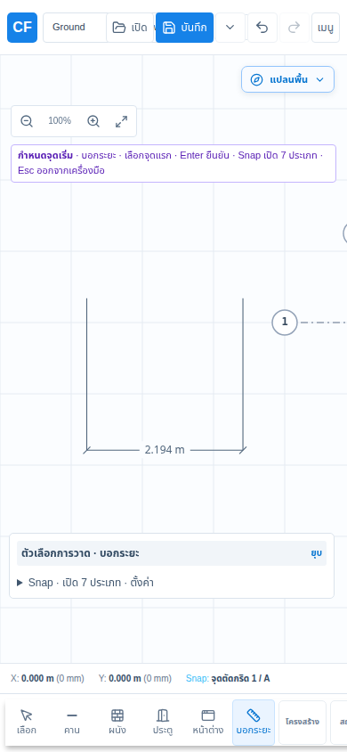

# Grid dragging, snapping and plan dimensions — 2026-10-16

## Delivered workflow

- **Snapping:** drawn/angled grids now offer exact grid intersections, mixed drawn/system-grid intersections, and grid/model crossings. Endpoint/midpoint/edge targets include foundations, polygon surfaces/voids, routed paths and hosted-opening jambs. The spatial broad phase includes these families. Automatic horizontal/vertical inference uses screen-space tolerance from the last point while retaining exact object snaps. Ctrl temporarily disables snapping. Beam support acquisition uses the acquired column, replacing the old first-nearby-column search. Snap labels use dark text on a light background.
- **Grid-system members:** Select and drag a grid line or its middle grip. Movement follows its own axis, previews before release, and commits one command. UUIDs, tags and system membership remain stable. Shared positions, origin and spacing metadata reconcile for all members. Crossing a neighboring line or leaving a gap below 1 mm rejects the edit; Escape cancels. Independent grids keep their existing move/endpoint workflows.
- **Dimensions:** the pinned **บอกระยะ** button / **Shift+M** takes two points and a third placement point. It previews the calculated length and witness lines. In Select, drag the dimension line to change its offset, drag endpoint grips to change its length, and use Delete or **ลบระยะ** to remove it. Enter places the current point; Escape cancels the pending step. **M** remains the temporary tape measure.
- Saved dimensions carry a persistent UUID, level and mandatory `created_phase`; geometry remains millimeters and labels follow the display unit. Optional `drawing_settings.plan_dimensions` uses the existing project version 2 envelope. `SavePlanDimension` / `DeletePlanDimension` use the shared CommandBus/history session. A-02/A-03 vector sheets include dimensions for their level and visible phase and retain their chosen offsets.

## Verification

- Project model suite: 60 passed.
- Command runtime suite: 132 passed.
- Sheet engine suite: 51 passed.
- Focused snapping/editor/geometry/runtime/vector regression run: 57 passed before the additional beam-support regression was added.
- Latest snapping/placement regression: 33 passed, including nearest beam-support acquisition. Tool-session regression: 7 passed.
- Production editor build (`npm run build --prefix apps/plan-editor`) passed; dependency packages were compiled in dependency order. Vite retains the existing large-chunk and LibreDWG external-module warnings.
- Browser acceptance: 7/7 passed in the final combined run; all 3 new grid/dimension workflows passed again after simplifying the grid movement fields. The mobile touch workflow passed again after the final hint layout change.
- Browser coverage includes grid preview pixels, movement, cancellation, Undo/Redo, UUID preservation and reload; dimension creation, endpoint/offset editing, Undo/Redo, .cfproj download/reimport and reload, deletion, keyboard cancellation, and mobile touch placement.
- Environment: Linux, Node, Chromium `/usr/bin/chromium`; Playwright on `127.0.0.1:5184`, desktop 1366×900 and mobile 390×844 with touch enabled.

## Scope limits

- Dimensions reference user-placed coordinates. Snapping copies an object coordinate; it does not add a persistent associative constraint to that object. Editing a dimension endpoint recalculates its displayed value; moving the original model object does not move the dimension automatically.
- The added sheet output is A-02/A-03 vector drafting; no new native CAD DIM entity contract is introduced.
- Browser checks use local fixtures. No live deployment or physical-device acceptance is implied.

## Browser evidence

Run: `PLAYWRIGHT_EXECUTABLE_PATH=/usr/bin/chromium npm run test:e2e -- e2e/grid-dimensions.spec.ts e2e/authoring-workflows.spec.ts --workers=1 --grep 'system grid lines drag|dimension tool snaps|dimension keyboard|mouse and keyboard authoring|beam placement clears|grid-system placement validates|beam chains accept'` from `apps/plan-editor`.

Result: **7 passed**. The legacy authoring acceptance had two stale assertions expecting the raw `structure.column` UI label; these now check actual persisted column counts after mouse/keyboard placement, consistent with the existing short Thai names.

## Changed files

- `apps/plan-editor/e2e/authoring-workflows.spec.ts`
- `apps/plan-editor/e2e/grid-dimensions.spec.ts`
- `apps/plan-editor/src/app.css`
- `apps/plan-editor/src/app/placementLineSnap.d.mts`
- `apps/plan-editor/src/app/placementLineSnap.mjs`
- `apps/plan-editor/src/app/toolInteractionRegistry.d.mts`
- `apps/plan-editor/src/app/toolInteractionRegistry.mjs`
- `apps/plan-editor/src/app/toolInteractionStatus.mjs`
- `apps/plan-editor/src/app/useWorkbenchKeyboardShortcuts.ts`
- `apps/plan-editor/src/components/GridPropertiesSection.tsx`
- `apps/plan-editor/src/components/PlanCanvasAuthoringControls.tsx`
- `apps/plan-editor/src/components/PlanCanvasDragDimensions.tsx`
- `apps/plan-editor/src/components/PlanCanvasEditHandles.ts`
- `apps/plan-editor/src/components/PlanCanvasSurface.tsx`
- `apps/plan-editor/src/components/PlanDimensionLayer.tsx`
- `apps/plan-editor/src/components/Toolbar.tsx`
- `apps/plan-editor/src/components/buildPlanCanvasDragCommands.ts`
- `apps/plan-editor/src/components/commitPlanCanvasLinePlacementPoint.ts`
- `apps/plan-editor/src/components/createPlanCanvasPlacementCommitHandlers.ts`
- `apps/plan-editor/src/components/drawPlanCanvasSelectionHandles.ts`
- `apps/plan-editor/src/components/handlePlanCanvasPlacementPointerDown.ts`
- `apps/plan-editor/src/components/handlePlanCanvasSelectionPointerDown.ts`
- `apps/plan-editor/src/components/planCanvasPlacementConstraints.mjs`
- `apps/plan-editor/src/components/resolvePlanCanvasPointerSnap.ts`
- `apps/plan-editor/src/components/usePlanCanvasManipulationDimensions.ts`
- `apps/plan-editor/src/components/usePlanCanvasPlacementKeyboard.ts`
- `apps/plan-editor/src/components/usePlanCanvasPlacementSession.ts`
- `apps/plan-editor/src/components/usePlanCanvasPointerInteractions.ts`
- `apps/plan-editor/src/components/usePlanCanvasSurfaceController.ts`
- `apps/plan-editor/src/components/usePlanCanvasToolController.ts`
- `apps/plan-editor/src/directManipulation.mjs`
- `apps/plan-editor/src/rendering/planRenderer.ts`
- `apps/plan-editor/test/grid-system-drag.test.mjs`
- `apps/plan-editor/test/tool-session.test.mjs`
- `docs/GRID-SNAP-DIMENSIONS-2026-10-16.md`
- `docs/architecture/COMMAND-CATALOG.md`
- `docs/assets/grid-snap-dimensions-2026-10-16/mobile-dimension.png`
- `packages/command-runtime/src/projectCommands.ts`
- `packages/command-runtime/test/plan-dimension.test.mjs`
- `packages/command-schema/src/projectCommands.ts`
- `packages/geometry-kernel/src/alignedDimension.ts`
- `packages/geometry-kernel/src/index.ts`
- `packages/geometry-kernel/test/aligned-dimension.test.mjs`
- `packages/project-model/src/index.ts`
- `packages/project-model/src/migrations.ts`
- `packages/project-model/src/planDimension.ts`
- `packages/project-model/src/sheetSettings.ts`
- `packages/sheet-engine/src/permit.ts`
- `packages/sheet-engine/test/plan-dimension.test.mjs`
- `packages/snapping-engine/src/index.ts`
- `packages/snapping-engine/test/drawing-snaps.test.mjs`
- `packages/structure-engine/src/index.ts`
