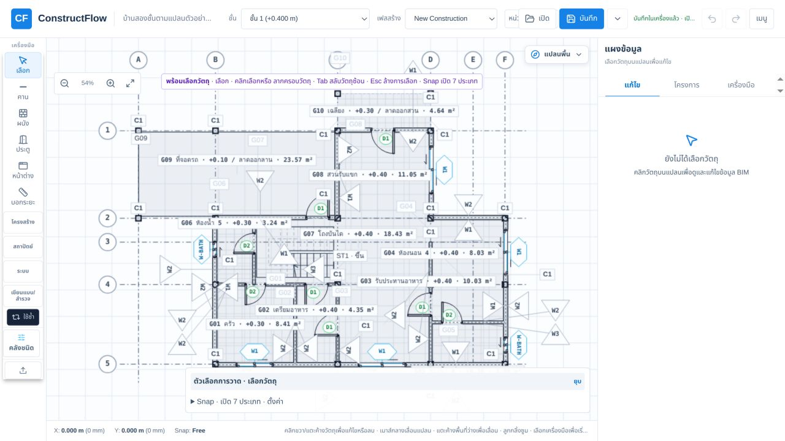
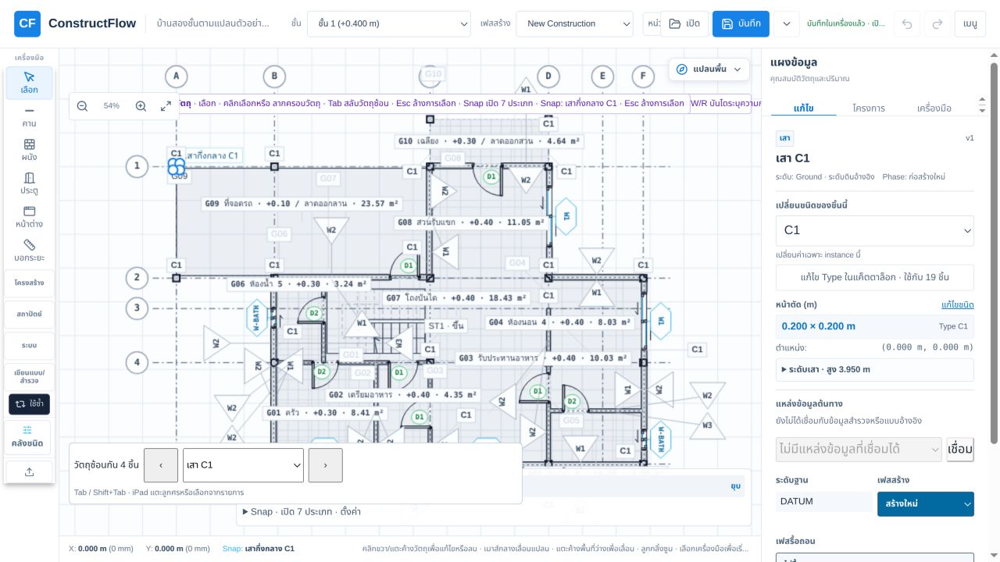
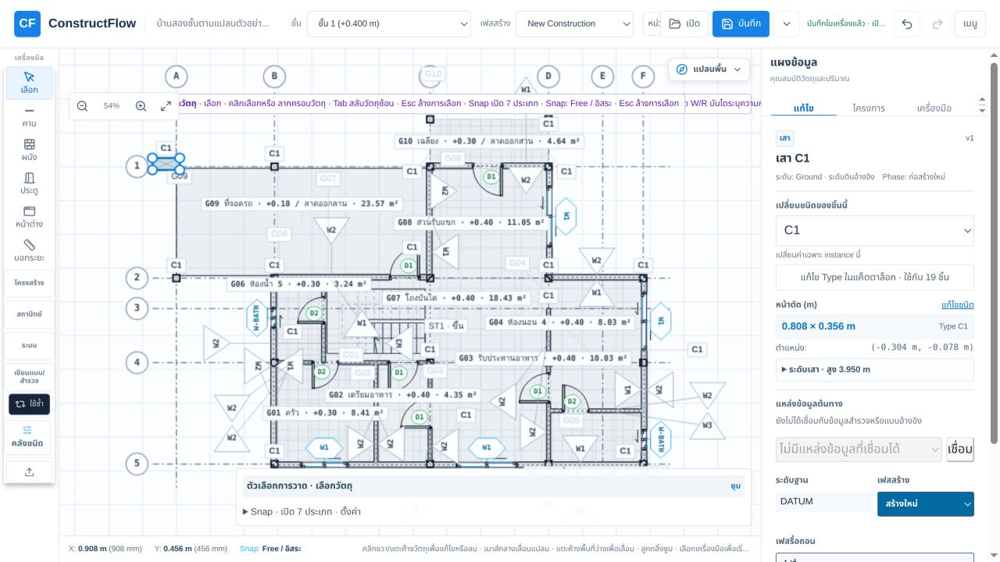
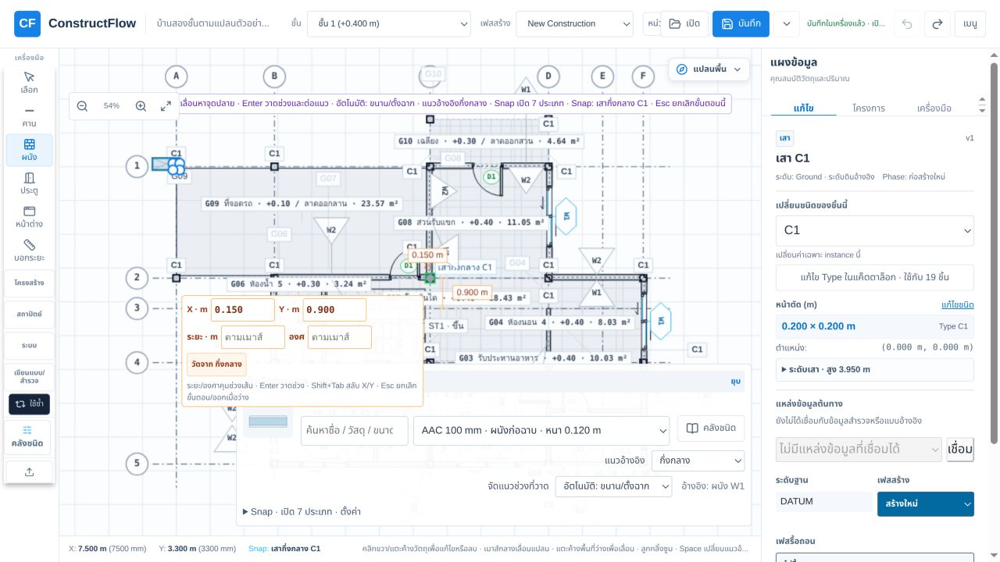
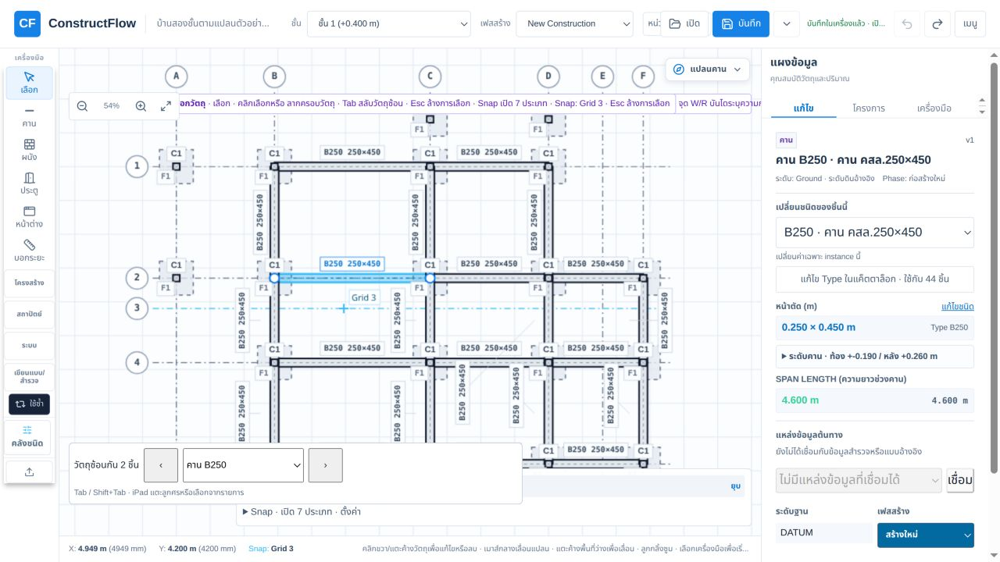
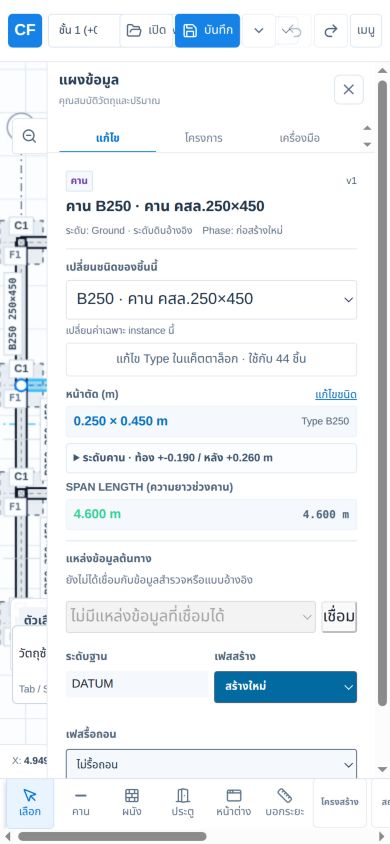
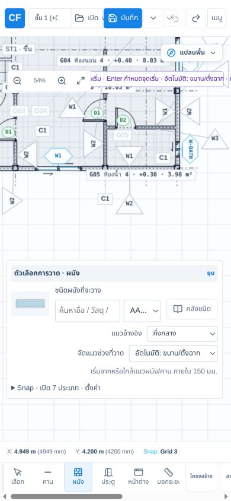
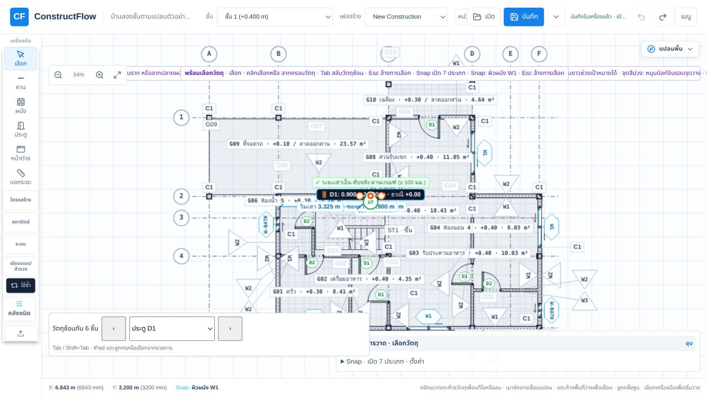
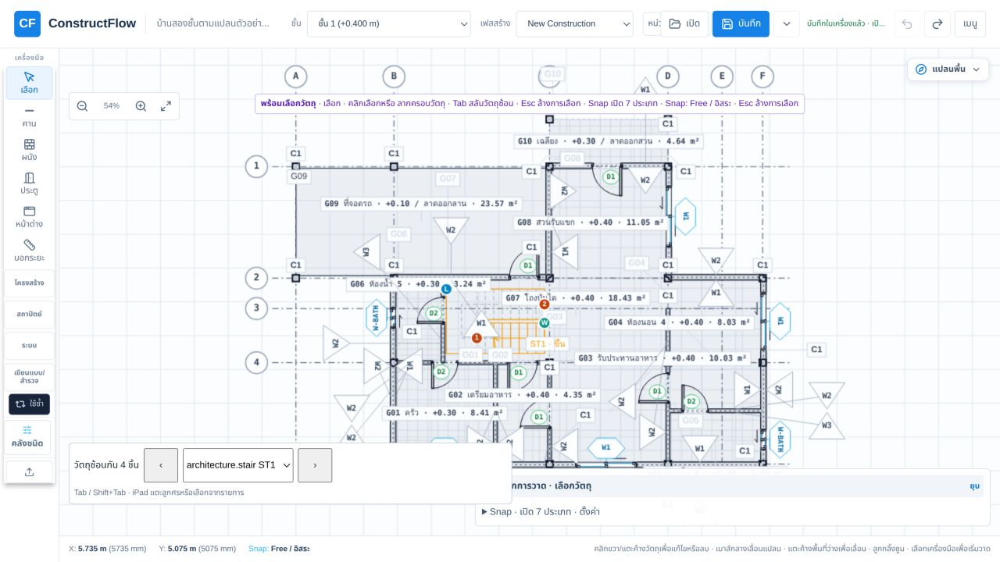
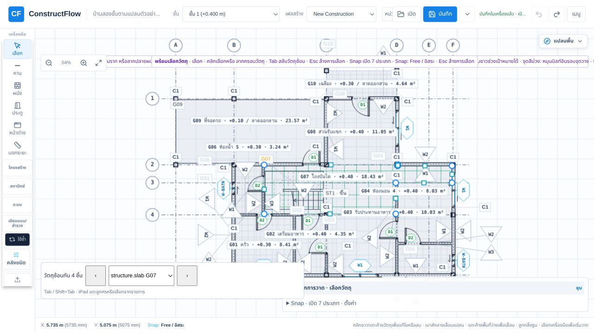

# ตรวจ UX การวาง สแนป และย้ายโมเดล — 16 ตุลาคม 2026

## ขอบเขตและหลักฐาน

ตรวจ working tree ที่ `http://localhost:5183/` ผ่าน Codex in-app browser บนบ้านตัวอย่างสองชั้น ไม่ใช่ production ที่ deploy แล้ว จอ desktop เริ่มประมาณ 1280 × 720 และตรวจ responsive ที่ 390 × 844 ด้วย viewport override ไม่ใช่โทรศัพท์จริง

**ผลรวม:** มีเครื่องมือและจุดจับหลายตระกูลแล้ว แต่การแยกเจตนา “เลือก / ย้าย / ปรับขนาด” ยังคาดเดายาก โดยเฉพาะเมื่อซูมออก วัตถุซ้อนกัน และวัตถุที่ผูกกับ host ควรแก้ความถูกต้องของการเลือกและลากก่อนเพิ่มจำนวน snap

- **พบจริง:** ทำ interaction ใน browser รอบนี้และมีภาพประกอบ
- **จากโค้ด:** ยืนยันเส้นทาง implementation แต่ยังไม่ได้ทำ browser acceptance ของกรณีนั้นในรอบนี้
- **ข้อเสนอ:** พฤติกรรมที่ควรเพิ่ม ไม่ใช่คำกล่าวว่ามีแล้ว
- **P1:** ควรแก้ก่อน เพราะเปลี่ยนชิ้นงานผิดเจตนาหรือขัดขวางการแก้โมเดล
- **P2:** เพิ่มความชัดเจน ความเร็ว และความสม่ำเสมอหลังปิด P1

## ขั้นตอนที่ตรวจบนหน้าจอ

### 1. เปิดบ้านตัวอย่างและจัดภาพพอดี — ใช้งานได้ แต่แน่น

มีชื่อมุมมองปัจจุบัน ปุ่มซูม และเลือกวัตถุซ้อนกันได้ อย่างไรก็ตาม ป้ายห้อง ช่องเปิด และรหัสโครงสร้างทับกันหลายตำแหน่ง แถบขั้นตอนยาวจนชนปุ่มซูม/ขอบ canvas ควรลดป้ายตามระดับซูม และเน้นรายละเอียดเฉพาะชิ้นที่ hover หรือเลือก

### 2. เลือกและลากเสา — พบข้อผิดพลาด P1

คลิกเสามุมซ้ายบนที่ประมาณ (225,213) แล้วลากจุดเดิมไป (265,233) ขณะเสาถูกเลือก หน้าตัดเปลี่ยนจาก **0.200 × 0.200 ม. เป็น 0.808 × 0.356 ม.** ตำแหน่งเปลี่ยนด้วย แทนที่จะเป็นการย้ายทั้งชิ้น จากนั้น Undo คืนเสาเดิมสำเร็จ

สาเหตุสอดคล้องกับโค้ด: hit radius ของ grip เท่ากับ 13 px และตรวจ grip ก่อนตัววัตถุ เสา 200 มม. ที่ zoom ประมาณ 0.043 มีขนาดเพียง 8.6 px จึงมีบริเวณกด grip ทับกลางเสา อีกทั้งเลือก grip ตัวแรกที่เข้าเงื่อนไข ไม่จัดอันดับตามระยะใกล้ที่สุด

ควรมี grip สำหรับย้ายที่ชัดเจน เก็บตำแหน่งที่จับ และซ่อน/กระจาย grip ปรับขนาดเมื่อเล็กเกินใช้งาน ให้ “ย้าย” เป็นพฤติกรรมเริ่มต้นบนตัวเสา

หลักฐานโค้ด: `PlanCanvasEditHandles.ts:15–32`, `handlePlanCanvasSelectionPointerDown.ts:59–99` และ `directManipulation.mjs:328–330` ซึ่งเส้นทางย้ายเสายังใช้พิกัด cursor เป็นศูนย์กลางโดยตรง จึงเสี่ยงกระโดดเมื่อเริ่มจับเยื้องศูนย์ แม้แก้เรื่อง grip แล้ว

### 3. เริ่มวาดผนัง — ทำได้ แต่ตัวช่วยบังงาน

เลือกผนังและแตะจุดเริ่ม มี snap ที่เสา ระยะชั่วคราว X/Y ช่องความยาว/องศา และแนวอ้างอิงให้ใช้งาน แต่ inspector ยังแสดงเสาที่เลือกก่อนหน้า ขณะเดียวกันแผงชนิดผนังและกล่องกรอกระยะบังพื้นที่กำลังวาด ควรมีตัวเลือกหลักแถวเดียว และรายละเอียดเปิดเมื่อจำเป็น พร้อมบอกบริบทว่า “กำลังวาดผนัง” ให้ชัด

### 4. เลือกคานที่ผูกเสาแล้วลากตัวคาน — ไม่ขยับและไม่มีเหตุผลบอก P1

เลือกคาน B250 ระหว่างเสาแล้วลากตัวคานลง คานคงตำแหน่งเดิม ปุ่ม Undo ยัง disabled และไม่มีข้อความอธิบายข้อจำกัด พบว่า `moveSingleObject` คืน `null` สำหรับคานที่มี `start_column_id` หรือ `end_column_id`

ควรแสดง “คานผูกกับเสา: ย้ายเสารองรับหรือแก้จุดปลาย” พร้อมเน้นเสาที่เกี่ยวข้อง ทางเลือกย้ายพร้อมเสาหรือปลดการผูกต้องระบุชัดก่อน preview โดยไม่ปลดความสัมพันธ์อัตโนมัติ

### 5. ตรวจจอมือถือ — ต้องปรับพื้นที่ทำงาน P1/P2

เมื่อ inspector เปิด กินความกว้างเกือบทั้งจอ เหลือแปลนเป็นแถบแคบ ต้องปิดก่อนลาก เมื่อเริ่มวาดผนัง แผงตั้งค่าด้านล่างสูงประมาณ 230 px คำแนะนำขั้นตอนแสดงบรรทัดเดียวและถูกตัด/ทับปุ่มซูม ชื่อชนิดผนังใน select เหลือเพียง “AA…”

ควรใช้ bottom sheet ที่ย่อได้ พร้อมชื่อชิ้น/ชนิดสั้นแถวเดียว เมื่อเข้าสู่การลากให้ยุบรายละเอียดและมีปุ่ม **ยืนยัน / ยกเลิก** ที่เข้าถึงได้ด้วยนิ้ว ไม่พึ่ง Escape/Enter อย่างเดียว ปรับจอแล้วกลับ desktop และ reset viewport override เรียบร้อย

### 6. เลือกประตู บันได และพื้นที่ซ้อนกัน — เลือกได้ แต่การจัดอันดับและชื่อยังไม่ชัด P1/P2

ประตูมีจุดกึ่งกลาง จุดขอบ ปุ่มกลับบาน และข้อมูลระยะ แต่ป้ายหลายชุดอยู่ชิดกัน เมื่อคลิกบริเวณบันได กลับเลือกประตู D1 ที่อยู่เหนือขึ้นไปก่อน ต้องใช้รายการซ้อนเลือกบันได จากโค้ดประตูใช้วงกลมรัศมี `width + openingTol` และได้ priority แรก จึงครอบพื้นที่ที่ไม่มีเส้นประตูจริง

รายการซ้อนช่วยให้เลือกบันไดและพื้นได้ แต่แสดง `architecture.stair ST1` และ `structure.slab G07` ควรใช้ “บันได ST1”, “พื้น G07” พร้อม preview เฉพาะรายการที่ชี้ การเลือกควรอิงเส้น/รูปทรงจริงและระยะจาก cursor มากกว่าประเภทตายตัว

## สิ่งที่ควรปรับแยกตามตระกูล

| ตระกูล | หลักฐาน/พฤติกรรมปัจจุบัน | สิ่งที่ควรปรับ | ลำดับ |
|---|---|---|---|
| เสา | พบจริง: กลางเสาถูก grip ยึดจนกลายเป็น resize; จากโค้ด: ย้ายใช้ cursor เป็นศูนย์กลาง | แยก grip ย้าย/ปรับขนาด; รักษาจุดที่จับ; ตัวเลือก snap ศูนย์กลาง/ผิวเสาตามงาน | P1 |
| ฐานราก | จากโค้ด: วางหาเสาตัวแรกในกรอบอย่างน้อย 400 มม.; ย้าย/resize ฐานรากผูกเสาอาจส่ง MoveColumn | ใช้เสาที่ snap ได้จริงหรือใกล้ที่สุด; highlight host ก่อนวาง; บอกเสา/คานที่จะตามไป; แยกย้ายชุดกับแก้ eccentric offset ตาม contract ที่รองรับ | P1 |
| ผนัง | พบจริง: วาดมีหลาย overlay; จากโค้ด: MoveWall ใช้ delta และมี endpoint grips | เลือกริม/แกนให้เด่น; preview รอยต่อและช่องเปิดที่ตาม; ลดแผงขณะวาด; ล็อกแนวอ้างอิงที่เลือก | P1/P2 |
| คาน | พบจริง: คานผูกเสาลากตัวแล้วเงียบ; จากโค้ด: ลากปลายออกนอกเสาอาจตั้ง column id เป็น null | แสดงข้อจำกัด; preview เสารองรับ; สถานะผูก/ปลดชัดเจน; ปลดความสัมพันธ์ต้องเป็นเจตนาที่ผู้ใช้เห็น | P1 |
| ประตู/หน้าต่าง | พบจริง: ประตูแย่งการเลือกบริเวณบันได; จากโค้ด: เคลื่อนบน host และปรับขอบได้ | hit test รูปทรงจริง; highlight ผนัง host; ล็อก host ระหว่างลาก; บอกวัดจากวงกบหรือศูนย์กลางและระยะถึงขอบเสา; Ctrl ให้ผลสม่ำเสมอ | P1 |
| พื้นโครงสร้าง | พบจริง: มี grip มุม/ขอบหลายจุด; จากโค้ด: ย้าย boundary และ voids พร้อมกัน | โหมดแก้ขอบชัดเจน; แยกย้ายทั้งชิ้น/จุด/ขอบ; ปุ่มเพิ่ม/ลบจุด; preview invalid boundary ก่อนปล่อย | P2 |
| พื้นสถาปัตย์/ฝ้า/ห้อง | จากโค้ด: มี polygon vertex; edge grip เฉพาะ slab; ย้ายพื้น/ฝ้าตั้ง follows_room_boundary=false | แสดงสถานะตามห้องและการปลดก่อน commit; ให้แก้ขอบได้สม่ำเสมอ; การย้ายห้องที่สร้างจาก boundary ต้องสื่อผลต่อพื้นที่ห้อง | P1/P2 |
| หลังคา | จากโค้ด: มี polygon/ridge/seam grips แต่การลาก ridge/seam ใช้ raw point ไม่ผ่าน snap ทั่วไป | แยกแก้ขอบ/สัน/ตะเข้; บอกชนิด grip; ให้ snap ตามแนวที่แก้ได้ และ preview รูปทรง/ระดับใน 3D | P2 |
| บันได | พบจริง: มี W/L/1/2 grips แต่ชื่อรายการซ้อนเป็นศัพท์ในโค้ด | ชื่อ “กว้าง / ช่วง 1 / ช่วง 2 / ชานพัก”; แสดงผลลูกตั้ง ลูกนอน จำนวนขั้นทันที; snap จุดขึ้น/ลงกับขอบช่องบันได | P2 |
| กริดเดี่ยว/ระบบกริด | จากโค้ดล่าสุด: ลากตัวเส้นและระบบกริดตามแกนได้แล้ว มี preview และ dimension axis | เพิ่มระยะระหว่างกริดข้างเคียงที่แก้ตัวเลขได้; แจ้งข้ามลำดับเส้นไม่ได้; แยกย้ายกริดกับย้ายโมเดลตามกริด โดยไม่ถือว่ามี association ถ้ายังไม่มี | P2 |
| ท่อประปา/ระบายน้ำ | จากโค้ด: วางทีละช่วงสองจุด; มีจุดปลาย/จุดกลาง แต่ปลายที่เชื่อม node ไม่ให้ลาก grip | snap connector และบอก “เชื่อมจริง/แค่ตรงตำแหน่ง”; preview IL/สโลปและผลต่อ node; ต่อแนวหลายช่วง; อธิบายปลายที่ล็อก | P1/P2 |
| โคม/สวิตช์/เต้ารับ/ตู้ไฟ | จากโค้ด: ใช้ generic point snap และย้าย XY | snap/จัดแนวตามบริบทผนังหรือฝ้า; preview ทิศทางและระดับติดตั้ง; วางซ้ำ/ระยะห่าง; อย่าแสดงว่า hosted ถ้ายังเป็นพิกัดอิสระ | P2 |
| บิลท์อิน | จากโค้ด: วางสองจุด มีหมุน grip และย้าย แต่ไม่มี grip resize ในตัวค้นหา handle นี้ | เกาะผิวผนังพร้อมทิศ/offset; grip ความยาว/ลึก; หมุนพร้อม snap มุมที่เกี่ยวข้อง; preview การชน | P2 |
| บัว/LED/เส้นแบ่งห้อง | จากโค้ด: บัว/เส้นแบ่งห้องวางทีละช่วง; บัวมี grip เฉพาะปลายที่ไม่ closed; LED มีเส้นทางย้าย | polyline ต่อเนื่อง; บอกผิว/ระดับอ้างอิง; แก้จุดกลาง/เข้ามุม/ปิดแนว; รายการเลือกใช้ชื่อไทย | P2 |
| บ่อพัก/ถังบำบัด/ชุดปั๊ม/ห้องน้ำ | จากโค้ด: มี move command ในตัว dispatcher แต่การสร้างบางส่วนผ่านเครื่องมืองานอาคาร | ให้เข้าสู่โหมดวางบนแปลนจาก dialog; preview footprint/ระดับ/จุดเชื่อม และพื้นที่ซ่อมบำรุง; จัด affordance ให้เหมือนเครื่องมือหลัก | P2 |
| เส้นบอกระยะ | จากโค้ด: มีพิกัดต้น/ปลาย/offset พร้อม command; ไม่ได้อ้าง UUID ของชิ้นงาน | เพิ่ม associative references; แสดงเมื่อหลุดจากชิ้นงาน; chain/baseline dimensions; แยกวัดชั่วคราวกับเส้นระยะถาวรให้เข้าใจง่าย | P1/P2 |
| ย้ายหลายชิ้น | จากโค้ด: snap ยกเว้นเพียง drag.id; group dispatcher อาจละคานที่ผูกเสา | ยกเว้นทั้งกลุ่มและชิ้นที่จะตาม host จาก snap; เลือก base point; preview ครบทุกชิ้น; รายงานชิ้นที่ย้ายไม่ได้ก่อน commit | P1 |

## การสแนปที่ควรปรับร่วมกัน

1. **เลือกจุดฐานในการย้าย:** เสาใช้ศูนย์กลาง แต่ผนัง/วัตถุทั่วไปใช้ delta จากตำแหน่งที่จับ ทำให้ผู้ใช้คาดเดาต่างกัน และ generic move snap ที่ cursor ไม่ได้รับประกันว่าขอบ/มุมชิ้นงานจะตรงเป้าหมาย เพิ่ม base point หรือจับ grip ที่ระบุได้
2. **คงเป้าหมายชั่วคราว:** engine จัดอันดับใหม่ตามระยะทุกครั้ง ยังไม่มี acquisition/release hysteresis ในฟังก์ชันนี้ เพิ่มการคงเป้าที่ได้ไว้จนออกจากระยะปล่อย เพื่อลดการสลับระหว่างมุม ผิว และกริด ต้องยืนยันอาการสั่นด้วย pointer trace เพิ่มเติม
3. **Snap ตามงาน:** คานเน้นเสารองรับ ผนังเน้นผิว/แกน ประตูเน้น wall host ท่อเน้น connector; ให้ override ได้ ไม่ใช่ซ่อนเป้าหมายที่ต้องใช้ และมีปุ่ม cycle เป้าหมาย snap แยกจาก Tab ที่ปัจจุบันใช้กับเลือกวัตถุ/ช่องระยะ
4. **ล็อก reference ของระยะ:** `findTemporaryDimensionRefs` หา X/Y ใกล้สุดใหม่ทุกครั้ง และคืนเพียงตัวเลข ไม่มี object id จึงอธิบายที่มาของระยะและล็อกอ้างอิงยาก ควรแสดงชื่อ reference และให้เลือก/ล็อกได้
5. **ความหมาย modifier:** การวางช่องเปิดเข้าสู่ wall host ก่อนตรวจ Ctrl ส่วนการลาก opening มี Ctrl ปิดระยะอัตโนมัติ ควรกำหนดให้ชัดว่า Ctrl ปิดระยะ snap แต่คงข้อบังคับ host พร้อมคำแนะนำบนจอ
6. **ผลกระทบก่อน commit:** ใช้ ghost ของทั้ง dependency set แสดงชิ้นตาม เส้นผูก ระยะ และเหตุผลที่วางไม่ได้ สีเพียงอย่างเดียวไม่พอ

## ลำดับทำงานและเกณฑ์ที่ควรใช้

1. **ความถูกต้องของเลือก/ลาก:** แก้ grip overlap, nearest-shape picking, grab offset, silent no-op และ preview การผูก host; ลองซ้ำทั้งซูมพอดี ซูมเข้า และวัตถุซ้อนกัน ลากเพื่อย้ายต้องไม่เกิดคำสั่ง resize
2. **ฐานการ snap/move ร่วมกัน:** ยกเว้นกลุ่มที่ย้ายทั้งหมด ล็อก reference และใช้ base point ที่เลือกได้; preview ต้องตรงผล commit เมื่อปิด snap ต้องไม่มีตำแหน่งกระโดดตอนเริ่มลาก
3. **workflow รายตระกูล:** เริ่มเสา/ฐานราก/คาน/ผนัง/ช่องเปิด แล้วกริด/พื้น/หลังคา/บันได ต่อด้วยงานระบบและบิลท์อิน ปิดแต่ละกรณีด้วย cancel, Undo/Redo และ save/reopen โดย UUID/host/phase ไม่เปลี่ยนผิดเจตนา
4. **มือถือและข้อมูลบนจอ:** ยุบตัวเลือกขณะลาก ใช้ bottom sheet และปุ่มยืนยัน/ยกเลิก มีเป้าสัมผัสแยกกันจริง คำแนะนำไม่ชน zoom หรือบังจุดวาง

## ความเสี่ยงด้านการเข้าถึง

- พบจริง: grip ทับกันตอนซูมออก กระทบคนใช้ pointer ไม่แม่นและจอสัมผัส; การขยาย hit radius โดยไม่จัดตำแหน่งใหม่จะทำให้กำกวมมากขึ้น
- พบจริง: คำแนะนำยาวถูกตัดและทับ control; รหัสภายในในรายการซ้อนเพิ่มภาระการอ่าน
- จากโค้ด: canvas ใช้ Tab สลับวัตถุและมี keyboard placement บางส่วน แต่ SVG dimension `tabIndex=-1` และ grip ส่วนใหญ่เป็น canvas ยังต้องตรวจทางเลือกคีย์บอร์ดสำหรับเลือกจุด/ย้าย/resize ทุกตระกูล รวม focus และ screen reader
- ยังไม่ตรวจ contrast เชิงตัวเลข, screen reader, keyboard end-to-end, high zoom ของ browser หรืออุปกรณ์สัมผัสจริง จึงไม่ใช่การรับรอง WCAG

## แหล่งโค้ดที่ตรวจ

- `apps/plan-editor/src/components/PlanCanvasEditHandles.ts`
- `apps/plan-editor/src/components/handlePlanCanvasSelectionPointerDown.ts`
- `apps/plan-editor/src/components/planHitTesting.mjs`
- `apps/plan-editor/src/components/resolvePlanCanvasPickCandidates.mjs`
- `apps/plan-editor/src/directManipulation.mjs`
- `apps/plan-editor/src/components/buildPlanCanvasDragCommands.ts`
- `apps/plan-editor/src/components/resolvePlanCanvasPointerSnap.ts`
- `apps/plan-editor/src/components/commitPlanCanvasPointPlacement.ts`
- `apps/plan-editor/src/components/commitPlanCanvasPlacementPoints.ts`
- `apps/plan-editor/src/components/PlanCanvasTemporaryDimensions.ts`
- `apps/plan-editor/src/components/handlePlanCanvasPointerDownNavigation.ts`
- `packages/snapping-engine/src/index.ts`
- `packages/project-model/src/planDimension.ts`

## ข้อจำกัดและการส่งมอบ

รอบนี้ตรวจ browser แบบเจาะจงตามหกขั้นตอนข้างต้นและอ่าน code path ของตระกูลที่เหลือ ไม่ได้สร้าง/ย้าย/resize ทุกชนิดครบ acceptance และไม่ได้รัน test suite หรือ build ใหม่ ภาพเป็นหลักฐานของ working tree ปัจจุบัน ไม่ยืนยัน production หรือความถูกต้องทางวิศวกรรมของบ้านจริง

การลากเสาที่ทดลอง Undo กลับแล้ว ปิดแท็บ audit และบันทึกแท็บโครงการเดิมกลับใน browser แล้ว รีสตาร์ต dev server ด้วย `--force` เพื่อแก้ dependency cache เก่าที่ทำให้แท็บใหม่ขาด export `alignedDimensionGeometry` มีเพียงรายงานและภาพ audit เพิ่มในรอบนี้ ไม่แก้ command/schema/UUID/phase หรือ implementation และไม่ commit/push
