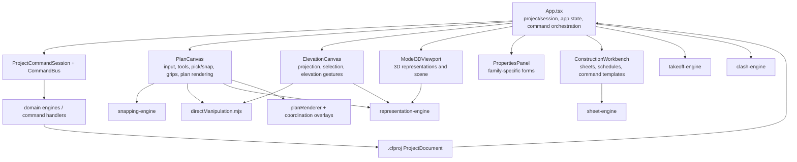

# Editor Hardening Audit — 2026-10

**Audit snapshot:** `main` at `304de69` (`Add roof framing and project rainwater design`), matching `origin/main`; working tree was clean before this audit.  
**Scope:** Plan Editor application and editor-facing package boundaries. This is a source inspection baseline, not a runtime or performance benchmark.

## Current source-file baseline

Sizes were measured from the checked-out files before this audit was added.

| File | Lines | Bytes | Main responsibilities observed |
| --- | ---: | ---: | --- |
| `apps/plan-editor/src/components/PlanCanvas.tsx` | 3,045 | 200,627 | Viewport and canvas lifecycle; plan filtering; pointer/keyboard events; selection and candidate cycling; snapping; tool state and drawing; temporary dimensions; family-specific grips; direct-manipulation previews; plan rendering and overlays. |
| `apps/plan-editor/src/App.tsx` | 2,372 | 153,578 | Project session and browser file lifecycle; autosave and dirty state; CommandBus execution/preview; project, view, selection and tool state; object command builders; property/editor callback plumbing; keyboard shortcuts; quantity/BOQ and export orchestration; main application shell. |
| `apps/plan-editor/src/components/PropertiesPanel.tsx` | 1,783 | 147,890 | Selected and multi-selected object resolution; common identity/phase/type/level controls; family-specific property forms and validation presentation; roof/rainwater and site/legal/room compliance displays; command callbacks. |
| `apps/plan-editor/src/components/ConstructionWorkbench.tsx` | 1,407 | 55,859 | Construction command templates and sample payloads; model workbench; sheet selection and viewport controls; drawing compilation, preview and PDF export; schedules and opening-symbol editing. |
| `apps/plan-editor/src/components/ElevationCanvas.tsx` | 616 | 49,896 | Elevation/RCP projection and canvas rendering; representation visibility and depth clipping; labels/tags; local pan/zoom; box selection; elevation manipulation preview and pointer handling. |
| `apps/plan-editor/src/components/Model3DViewport.tsx` | 689 | 44,918 | Three.js representation-to-mesh conversion; scene/camera/controls; object selection and movement; coordination highlights; roof framing visibility; disposal and render lifecycle. |
| `apps/plan-editor/src/directManipulation.mjs` | 395 | 26,188 | Family-specific gesture-to-command construction; optimistic preview project creation; command preview result and manipulation helpers. Type declarations live in the adjacent `.d.mts`. |

## Editor dependency and responsibility map



The semantic model and `CommandBus` are already the mutation boundary. The main architectural pressure is that interaction policy and family-specific UI orchestration are spread across the application shell, two canvases, and the property panel.

## State owned by `App.tsx`

The root component declares roughly forty React state values. They currently cover several distinct lifecycles:

- **Project/session:** project document, saved/replacement serialized baselines, local autosave readiness/status, active file handle, file feedback, project-name edit draft, and command queue; `ProjectCommandSession` is held in a ref.
- **Editor context:** active tool, plan/framing/roof/elevation/3D view, label options, active phase/level (in the model), selected ID(s), cursor/snap status, and right-panel tab.
- **Tool configuration:** active type marks for columns/foundations/beams/walls/doors/windows/slabs/roofs; catalog intent/context; underlay image/visibility/opacity/calibration; and stair or discipline-specific tool defaults.
- **Workspace and dialogs:** inspector visibility, construction workbench tab/open state, settings, type manager, extension presets, calibration, and legal metadata dialogs.

The state categories are coherent, but they are co-located with hundreds of per-family create/edit handlers and the full shell. The project document is not intentionally mixed with ephemeral interaction state, although both are orchestrated by the same component.

## Callback and command flow

`App.tsx` builds most `Create*`, `Update*`, move/resize, delete, type assignment and phase commands. It passes a large callback surface into `PlanCanvas` and `PropertiesPanel`; many props correspond one-to-one with domain families. The app shell also constructs inline closures while rendering the canvas and inspector. This makes it difficult to see a family's full interaction contract in one place and increases the cost of adding or changing a family.

`PlanCanvas` receives dozens of callbacks plus active type/tool/view context. It owns pointer-to-intent interpretation, while `App.tsx` owns many command payloads and `CommandBus` invocation. `PropertiesPanel` dispatches via callbacks to the same root handlers. `ConstructionWorkbench` has its own command-batch interface. The shared semantic command boundary exists, but it is not yet presented through a small typed editor-session facade.

## Interaction responsibilities and duplication

- **Plan:** `PlanCanvas` owns pan/zoom transforms, pick ranking/cycling, click/marquee and multi-selection behavior, snap and hosted-opening snaps, placement state, dynamic dimensions/constraints, drawing lifecycle, context menu, family-specific grips and preview ghosts. `rendering/planRenderer.ts` owns most plan primitives and labels, but the component still contains substantial family-specific geometry and gesture logic.
- **Elevation:** `ElevationCanvas` separately owns per-direction viewport state, selection box and pointer state. It builds visible representations, handles elevation-space hit/box selection and communicates candidate deltas through the App-provided manipulation callbacks. `App.tsx` separately implements `buildElevationManipulationCommands` and vertical-intent mapping.
- **Shared manipulation:** `directManipulation.mjs` is already a reusable command builder/preview utility and is used by PlanCanvas. Elevation uses a separate manipulation entry path. Both preserve candidate preview and command commit semantics, but gesture contracts and family capability routing are not unified.
- **Tool sessions:** PlanCanvas currently stores tool-specific state for beams, walls, room separators, slab polygons, roof options, pipe system, fixture kind, stair options and temporary dimensions. Lifecycle policy is consequently embedded in the canvas event branches rather than registered per tool/family.
- **Keyboard:** `App.tsx` installs global project/editor shortcuts, while PlanCanvas handles canvas dimension input and pointer keyboard context; individual controls also implement their own Enter/Escape behavior. Focus guards exist, but ownership is distributed.
- **View filtering:** PlanCanvas asks `representation-engine` for visible plan objects and a plan project. Elevation and 3D independently request/build representation data with their own view filtering and drawing lifecycle.

## Inspector responsibilities

`PropertiesPanel` resolves the current and bulk selection, type compatibility, common level and phase actions, then renders a large conditional family tree for structure, walls/openings, floors/ceilings/slabs, roofs and rainwater, MEP, cabinetry, mouldings, rooms and grids. The component contains UI-level derived presentation logic and property form transformations. Engineering resolution helpers and legal/ventilation evaluators are imported from domain packages, which is the correct ownership direction, but the registry/editor decomposition described in the sprint request is not present yet.

## Project, rendering, and mutation boundaries

- **Persistence:** `App.tsx` coordinates `.cfproj` open/save and local autosave using `projectFileIO.js` and `projectAutosave.ts`; serialization/migrations are in `project-model`.
- **Mutation:** `App.tsx` and workbench callbacks submit requests/batches through `CommandBus`/`ProjectCommandSession`. Plan drag previews use the same batch validation path and commit on release. Keep this as the invariant during refactoring.
- **Plan rendering:** `PlanCanvas` calls `renderPlanView`; `planRenderer.ts` renders semantic plan data and phase/label/coordination overlays.
- **Elevation rendering:** ElevationCanvas creates projected visible object data and draws it in a canvas effect, including depth-clipped geometry and labels.
- **3D rendering:** Model3DViewport calls `buildProjectRepresentations3D` and turns renderer-neutral shapes into Three.js meshes. It is lazy-loaded by App.
- **Sheets:** ConstructionWorkbench calls `compilePermitDrawingSet` for sheet lists and previews and `compilePermitPdf` for export. The workbench is lazy-loaded, while sheet/DXF/IFC entrypoints are also loaded on demand from App.

## Performance hotspots to measure

These are source-level candidates, not measured latency claims:

1. `snapping-engine` iterates `Object.values(project.objects)` for snap candidate discovery. PlanCanvas invokes `snapPoint` in pointer-move and drag paths, making candidate lookup a whole-document scan at interaction frequency.
2. PlanCanvas memoizes `getPlanVisibleObjects` and `getPlanViewProject`, but both recompute for each new project reference. Rendering and helper paths also scan objects for temporary dimensions, selection, host targets and family-specific geometry.
3. App computes six category counts and six type-count reductions directly during render; `calculateTakeoff` and `calculatePhasedBOQ` are memoized only by the whole project reference, so every committed model update invalidates both.
4. `useCoordinationReport` memoizes `runCoordination` by project reference. Each project update invalidates it when coordination review is enabled.
5. Model3DViewport rebuilds all project representations and meshes when its project-dependent scene effect runs. This is correctly deferred until the lazy viewport is mounted but is not incremental by object.
6. ConstructionWorkbench memoizes available sheets but invokes complete drawing-set compilation in sheet preview/export handlers; repeated viewport edits can compile the whole set for one preview.
7. ElevationCanvas builds/retrieves visible representations and scans project objects in its drawing effect; behavior and cost across a 5,000-object project are not measured here.

The first baseline should isolate each operation at 500/1,000/5,000 objects before deciding which cache/index gives the most value. Interactive preview must remain lighter than committed output generation.

## Cross-cutting findings and constraints

- **Selection:** selection ownership is split: App stores selected IDs; PlanCanvas owns pick/marquee mechanics; ElevationCanvas owns its hit and box-selection mechanics; 3D stores hover and reports selection.
- **Snapping:** snap modes and semantic candidates are called from PlanCanvas; candidate discovery is currently linear in object count. Reuse domain exact checks after introducing any broad-phase index.
- **Validation/preview:** Plan previews route candidate command batches to the central CommandBus validator. Release revalidates and commits. This is an important existing contract; do not replace it with local geometry mutation.
- **Expensive derived data:** takeoff/BOQ, coordination, representation generation and sheet compilation are tied to whole-project identity or explicit repeated calls. There is no evidence yet of change-scope-aware derived caching for these paths.
- **Acceptance gaps already documented:** the 2026-10-13 capability matrix calls out 5,000+ object snap/search performance, family-accurate elevation ghosts and multi-select elevation movement, among other interaction gaps. `docs/STATUS.md` records broad test/build evidence but also explicitly leaves live visual acceptance and oversized Vite chunks open.

## Refactoring guardrails

1. Preserve `ProjectDocument` as the sole model state and route mutations through commands.
2. Keep family rules and derived quantities in owning domain packages.
3. Preserve UUID, host, type, phase, level, undo/redo and `.cfproj` round-trip behavior.
4. Extract cohesive contracts and behavior, not code solely to reduce file size.
5. Keep preview and commit on the same command/validation path.
6. Treat performance as unmeasured until the deterministic harness is run; do not report browser FPS based on inference.

## Suggested dependency direction after decomposition

```text
App shell / project session
  └── editor context + command facade
       ├── ToolSession registry → family tool providers
       ├── Interaction capability registry → plan/elevation grip providers
       ├── Plan canvas shell → viewport / picking / selection / snapping / overlays
       ├── Elevation canvas shell → projection / shared selection & manipulation intents
       ├── Inspector shell → common sections + family property editors
       └── Representation consumers → plan / elevation / Three.js / sheets

All mutation: interaction intent → typed command request → CommandBus → domain owner
```

The first implementation slice after this baseline should establish characterization coverage for existing shell/canvas behavior, then extract one cohesive session boundary before changing the interaction implementations.

## First hardening slice completed

After the baseline audit, the existing standalone suite passed before application decomposition: 439 Node tests, 11 Python tests, 25 build targets and five integration verifiers. The Plan Editor suite already contains family-aware direct-manipulation candidate tests and elevation projection/viewport behavior tests; those were run before and after the first slice.

- Project document state, `ProjectCommandSession`, command-batch execution and candidate validation were moved behind `apps/plan-editor/src/app/useProjectSession.ts`. App still owns browser file persistence, presentation feedback, and the ref-driven keyboard shortcuts; further session extraction is still needed.
- App's sheet HTML exporter and reference-house fixture are now dynamically imported only when the user invokes those paths. The current minified initial application chunk is 1,253.86 kB, down 397.23 kB from the pre-sprint 1,651.09 kB; the 398.83 kB house fixture is emitted separately. The PDF (1,150.90 kB) and Three.js vendor (580.50 kB) chunks remain above Vite's 500 kB warning threshold.
- The standalone runner now generates `docs/generated/BUILD-STATUS.md` with commit, build targets, suite counts, integration results and oversized JavaScript chunks. README points to that generated current status. Historical dated counts remain dated.
- Plan snapping now builds a per-plan-snapshot `SnapSpatialIndex` and uses it for point and hosted-opening candidate broad phases. Exact geometry projection, snap tolerance and ranking still run in `snapPoint`/`snapToWallHost`. An equivalence regression test covers indexed and full-scan results with distant objects, columns, grids, walls and beam geometry. The deterministic Node probe in `docs/performance/PERFORMANCE-BASELINE-2026-10.md` measured the 5,000-wall sparse fixture at 173.499 ms full scan versus 0.032 ms indexed snap (median of seven paired samples; index build 6.511 ms).
- App's object-summary counts now use one `countProjectObjects` pass memoized on the semantic project reference instead of thirteen per-render whole-project scans; the obsolete type-count reductions were unused and removed. This reduces work during cursor/status-only App rerenders without introducing stale counts after model edits.
- The active roadmap already labels Pillar 6 as candidate detection with incomplete MEP clearance coverage, so no roadmap status correction was needed in this slice.

| Editor file | Before | After current slice |
| --- | ---: | ---: |
| `App.tsx` | 2,372 lines / 153,578 bytes | 2,310 lines / 150,815 bytes |
| `PlanCanvas.tsx` | 3,045 lines / 200,627 bytes | 3,056 lines / 200,774 bytes |
| `PropertiesPanel.tsx` | 1,783 lines / 147,890 bytes | 1,783 lines / 147,890 bytes |

This slice does not yet decompose PlanCanvas or PropertiesPanel, consolidate plan/elevation interaction providers, or establish the full 500/1,000/5,000-object matrix for project, representation, coordination, quantity, drawing and history operations. Those remain the next architectural and acceptance work.
